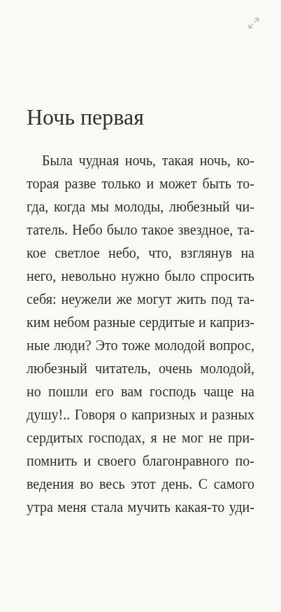
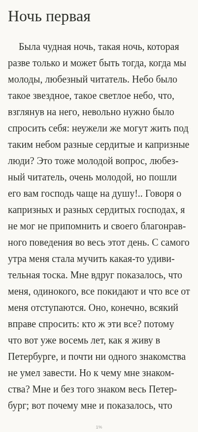

# BOOK 1.0.1 — полноэкранное чтение

Дата: 26 октября 2026 года. Изменён существующий reader; формат базы, импорт, оригиналы книг и библиотека сохранены. Vercel: существующий проект `book`, `prj_ZO29qu33KuxoiaPto5pU1Hfi3PSV`.

## Диагностика и результат

Приложенный пользователем скриншот не был доступен в сообщении. Ошибка воспроизведена на исходном коммите `a9ff885` и подтверждена снимком браузера и измерениями DOM на 402 × 874 CSS px.

| Измерение | 1.0 | 1.0.1, компактные поля |
|---|---:|---:|
| Верх области книги (обычная вкладка, safe area = 0) | 95 px | 12 px |
| Высота области книги | 692 px | 836 px |
| Дополнительный внутренний padding EPUB.js | 20 px сверху/снизу, 14 px сбоку | 0 |
| Показ/скрытие панелей | Панели сохраняли строки сетки | Наложение поверх неизменной страницы |
| При имитации standalone с safe area 62/34 px | — | 740 из 778 безопасных px высоты |

Новые значения по умолчанию: горизонтальные поля 16 px, вертикальные 12 px, небольшой индикатор 14 px у нижней safe area, выравнивание влево. В 402 × 874 область книги занимает 95,7% viewport без системных отступов. При имитации системных отступов используется 95,1% безопасной высоты. Настоящие короткие главы и конец главы не растягиваются и не объединяются с последующей: исходная структура EPUB сохраняется.

Одинаковая глава, 402 × 874, шрифт 20 px; браузерная эмуляция без системных панелей:

| 1.0, панели скрыты | 1.0.1, панели скрыты |
|---|---|
|  |  |

## Фактические изменения

- `100dvh`; для Safari без поддержки этой единицы — `100vh` и высота из `visualViewport.height`/`innerHeight`. Пересчёт выполняется при изменении размеров, без обработчика движения пальца для layout.
- Safe area со всех четырёх сторон учтена отдельно от пользовательских полей. Верхние и нижние панели — абсолютный слой, по умолчанию скрыты. Одно касание центра показывает, повторное скрывает. Скрытые панели имеют `inert` и недоступны для случайного фокуса; отдельная кнопка меню проявляется при клавиатурном фокусе.
- Пресеты горизонтальных полей: 14, 22 и 36 px; пользовательский диапазон сохраняет прежние 8–48 px. Вертикальные поля: 0–48 px. Добавлены отступ первой строки, переключатели переносов и небольшого прогресса.
- Убраны неявные 20 px padding, динамический gutter EPUB.js и верхний margin первого элемента. Нет вертикального центрирования страницы.
- Размер шрифта не меняется при обновлении. Глубокое дополнение сохранённых настроек добавляет новые поля, сохраняя прежние шрифт, интервалы, выравнивание, яркость, тему и режим. Версия ключа Zustand не сбрасывается.
- `word-spacing: normal`, последняя строка по началу, `hyphens`/`-webkit-hyphens`, регулируемый отступ первой строки. Язык главы сохраняется; если не указан, используется язык метаданных книги. Наличие русского словаря переносов зависит от браузера и ОС.
- Единственный ResizeObserver следит за mount книги. Размеры передаются движку численно; дублирующие пересчёты по window/orientation внутри EPUB.js выключены. Серия настоящих изменений объединяется с задержкой 120 мс. Показ панелей, яркость и удержание экрана не перестраивают книгу.
- При перестройке сохраняется исходный CFI, отображается содержащая его новая страница, затем сохраняется тот же CFI. Промежуточные границы страниц не записываются в прогресс. Обычное перелистывание или прокрутка обновляет локатор. Индекс книги генерируется только при открытии, не при настройках.

## Автоматическая проверка

`npm run build` и TypeScript strict. Vitest: 13 тестов, включая дополнение настроек 1.0 без сброса старых значений. Playwright: 38 из 38 сценариев пройдено в Chromium и WebKit за 3,8 минуты. Prettier и проверка diff пройдены; `npm audit --omit=dev` — 0 известных уязвимостей.

Новые браузерные сценарии для Chromium и WebKit:

- EPUB и FB2 на каждой ширине 375, 390, 402 px; портрет 874 px и альбомная ориентация.
- Скрытые панели по умолчанию; три последовательных цикла показа/скрытия без изменения размеров, замены iframe и изменения CFI.
- Перелистывание нескольких заполненных страниц; измерение прямоугольников текстовых строк, проверка отсутствия пустой страницы и вертикального обрезания.
- Шрифты 14 и 36 px: сохранение точного CFI и проверка видимости того же символа исходного текста после reflow.
- Свиток, настоящая прокрутка колесом и обновление прогресса; восстановление CFI после возврата в портретную ориентацию.
- Имитация standalone-флагов и safe area 62/34 px, затем горизонтальных отступов 62/62 px; кнопки и текст не заходят в заданные системные области.
- Пресеты, пользовательские поля, вертикальные поля, выключение индикатора, отступ первой строки и сохранение исходного числа/ID абзацев.
- Унаследованные 27 px, Palatino, сепия, ширина полей 38 px и другие значения остаются прежними. У главы с `lang=en` язык не заменяется русским.

Сохранены существующие сценарии импорта, чтения, CFI-восстановления, поиска, заметок, копий, офлайн-перезапуска и защиты от кода EPUB. В тестах прежнего reader обновлён только способ открытия скрытого меню.

## Границы проверки

Эмуляция viewport и Playwright WebKit на Linux не являются проверкой физического iPhone 17 или установленной iOS PWA. Standalone-флаги и системные отступы в автоматическом тесте имитируются; установка «На экран „Домой“», реальные значения safe area, панели Safari, нативное выделение и клавиатура требуют проверки на устройстве. Не заявляется измеренная частота 120 FPS.

Перед проверкой установленной PWA откройте библиотеку онлайн и примените предложенное обновление BOOK. Затем отдельно проверьте открытие книги из Safari и с домашнего экрана, поворот, нативный свайп, скрытие панелей и повторный офлайн-запуск. Старая установленная версия не обновляется посреди чтения принудительно.
